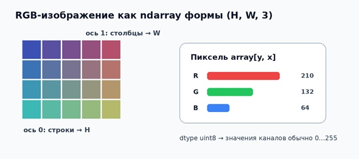
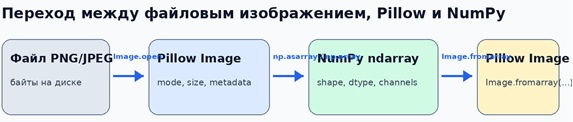
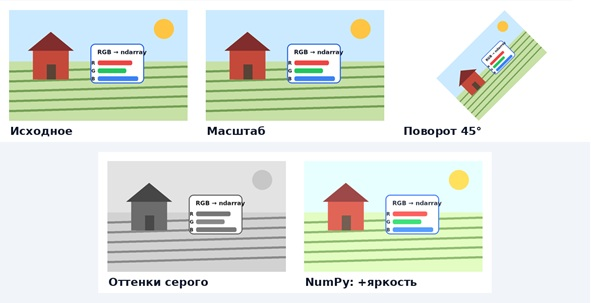

# Практическая работа № 1
## Работа с изображениями (Pillow, NumPy)

### 1. Назначение работы и ожидаемый результат
**Цель:** освоить базовый поток обработки растрового изображения в Python и научиться осознанно переходить между объектом Pillow и массивом NumPy.
- загрузить PNG/JPEG и проверить ключевые свойства изображения: формат, размер, режим и число каналов;
- представить изображение как numpy.ndarray, интерпретировать shape, dtype и порядок каналов;
- выполнить обязательные преобразования: изменение размера, поворот на 45°, перевод в оттенки серого;
- реализовать минимум одну операцию непосредственно над пиксельным массивом NumPy;
- визуально сравнить исходное и обработанные изображения и сохранить результаты без перезаписи исходника;
- объяснить, какие операции выполняет библиотека, а какие — собственный код студента.

### 2. Теоретический минимум
#### 2.1. Pillow: изображение как объект с режимом и размером
**Pillow** предоставляет объект Image. Для этой работы важны свойства size (ширина, высота) и mode (способ интерпретации каналов). Наиболее часто встречаются RGB, RGBA и L.
- RGB — три цветовых канала; для 8-битных изображений каждый канал обычно представлен значениями 0…255.
- RGBA — RGB плюс alpha-канал прозрачности. Alpha не является «ещё одним цветом».
- L — одноканальное изображение яркости (grayscale). Его NumPy-представление обычно двумерное.

#### 2.2. NumPy: изображение как многомерный массив


**Рисунок 1 — Интерпретация RGB-изображения как массива NumPy**

```
Ключевая договорённость
В массиве RGB формы (H, W, 3) пиксель обычно читается как array[y, x], а не array[x, y]. Первый индекс — строка (координата y), второй — столбец (координата x).
```

Для чтения без намерения изменять данные удобно использовать `np.asarray(image)`. Для гарантированно изменяемой копии — `np.array(image, copy=True)`. После вычислений значения следует привести в допустимый диапазон и `dtype`.


**Рисунок 2 — Основной поток данных Pillow ↔ NumPy**

### 3. Структура проекта
Рекомендуемая структура каталога

```
cg_pr01/
├── assets/
│   └── source.jpg
├── output/
└── main.py
```

### 4. Пошаговое выполнение
#### Шаг 1. Загрузите и нормализуйте изображение
**Базовая загрузка с проверкой ошибок**
```Python
from pathlib import Path
from PIL import Image, UnidentifiedImageError

INPUT_PATH = Path("assets/source.jpg")
OUTPUT_DIR = Path("output")
OUTPUT_DIR.mkdir(exist_ok=True)


def load_rgb(path: Path) -> Image.Image:
    if not path.is_file():
        raise FileNotFoundError(f"Файл не найден: {path.resolve()}")
    try:
        with Image.open(path) as src:
            src.load()              # чтение пикселей выполняется внутри with
            return src.convert("RGB")
    except UnidentifiedImageError as exc:
        raise ValueError(f"Файл не является поддерживаемым изображением: {path}") from exc


image = load_rgb(INPUT_PATH)
print("size:", image.size)
print("mode:", image.mode)
```

```
Почему convert("RGB")? 
Файл может быть палитровым, RGBA, CMYK или иметь другой режим. Для базовой лабораторной логики мы явно приводим вход к предсказуемому трёхканальному RGB. Исходный файл при этом не изменяется.
```

#### Шаг 2. Исследуйте NumPy-представление

```Python
import numpy as np

array = np.asarray(image)
print("shape:", array.shape)
print("dtype:", array.dtype)
print("min/max:", array.min(), array.max())
print("pixel [0, 0]:", array[0, 0])

means = array.mean(axis=(0, 1))
print(f"mean R={means[0]:.1f}, G={means[1]:.1f}, B={means[2]:.1f}")
```

#### Шаг 3. Измените размер с сохранением пропорций
**Масштабирование**
```Python
def resize_to_width(image: Image.Image, target_width: int) -> Image.Image:
    if target_width <= 0:
        raise ValueError("target_width должен быть положительным")
    scale = target_width / image.width
    target_height = max(1, round(image.height * scale))
    return image.resize(
        (target_width, target_height),
        resample=Image.Resampling.LANCZOS,
    )


resized = resize_to_width(image, 640)
```

```
Не задавайте ширину и высоту независимо без необходимости: это меняет соотношение сторон и визуально искажает объект.
```

#### Шаг 4. Выполните поворот на 45° без обрезания
**Поворот**
```Python
rotated = image.rotate(
    45,
    resample=Image.Resampling.BICUBIC,
    expand=True,
    fillcolor=(255, 255, 255),
)
```
```
Что делает expand=True?
Размер выходного холста увеличивается так, чтобы в него поместилось всё повернутое изображение. fillcolor задаёт пиксели, появившиеся вне исходного прямоугольника. Для изображения с прозрачностью вместо белого фона можно работать в RGBA.
```

#### Шаг 5. Получите изображение в оттенках серого
**Одноканальное представление**
```Python
gray = image.convert("L")
gray_array = np.asarray(gray)
print("gray shape:", gray_array.shape)
print("gray dtype:", gray_array.dtype)
```

#### Шаг 6. Реализуйте операцию над пикселями с NumPy
**Пример: изменение яркости**
```Python
def adjust_brightness(image: Image.Image, delta: int = 25) -> Image.Image:
    # int16 нужен, чтобы сложение не переполнило uint8 до clip().
    data = np.array(image, dtype=np.int16, copy=True)
    data = np.clip(data + delta, 0, 255).astype(np.uint8)
    return Image.fromarray(data)


brighter = adjust_brightness(image, 25)
```
```
Почему не data + 25 для uint8?
При арифметике в uint8 значения могут переполняться по модулю 256. Безопасный учебный шаблон: перейти во временный знаковый тип → выполнить вычисление → clip(0, 255) → вернуть uint8.
```

#### Шаг 7. Сравните результаты и сохраните их
**Визуализация и сохранение**
```Python
import matplotlib.pyplot as plt

fig, axes = plt.subplots(2, 3, figsize=(12, 7))
items = [
    (image, "Исходное"),
    (resized, "Размер 640 px"),
    (rotated, "Поворот 45°"),
    (gray, "Grayscale"),
    (brighter, "NumPy: яркость +25"),
]

for ax, (img, title) in zip(axes.flat, items):
    ax.imshow(img, cmap="gray" if img.mode == "L" else None)
    ax.set_title(title)
    ax.axis("off")

for ax in axes.flat[len(items):]:
    ax.axis("off")

fig.tight_layout()
plt.show()

resized.save(OUTPUT_DIR / "01_resized.png")
rotated.save(OUTPUT_DIR / "02_rotated.png")
gray.save(OUTPUT_DIR / "03_gray.png")
brighter.save(OUTPUT_DIR / "04_numpy_brightness.png")
```


**Рисунок 3 — Пример набора результатов**